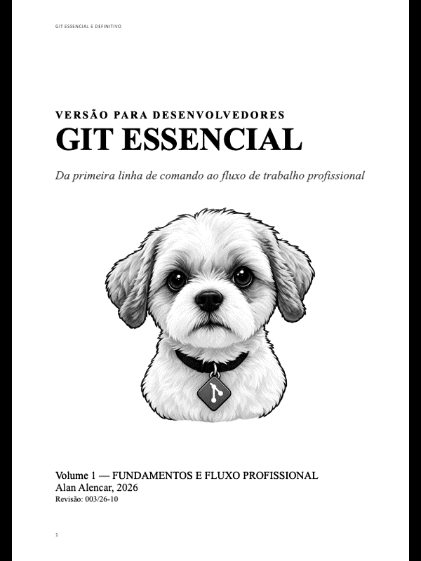

<div align="center">

# Git Essencial
### Versão para Desenvolvedores

**Um livro gratuito para aprender Git de verdade: do primeiro commit ao fluxo de trabalho em equipe.**

[](https://github.com/AlanAlencar/git-essencial/releases/latest/download/git-essencial.epub)
[](https://github.com/AlanAlencar/git-essencial/releases/latest/download/git-essencial.pdf)

[](https://creativecommons.org/licenses/by-nc-sa/4.0/deed.pt_BR)




</div>

---

## Sobre o livro

Git é a ferramenta de controle de versão usada por praticamente todas as equipes de desenvolvimento do mundo. Mesmo assim, muita gente aprende "na marra", decorando comandos sem entender o que acontece por trás deles.

**Git Essencial** foi escrito para mudar isso. Em linguagem direta e com exemplos práticos, o livro explica o *porquê* de cada conceito, para que você use o Git com segurança no dia a dia, e não apenas copie comandos da internet.

O livro é **100% gratuito** e pode ser distribuído livremente para fins educacionais.

## Para quem é este livro

| Perfil | O que você vai ganhar |
|---|---|
| 🌱 **Quem está começando** | Uma base sólida, do zero, sem pré-requisitos além de saber usar o terminal. |
| 🛠️ **Quem já usa Git** | Entender o que realmente acontece em `merge`, `restore`, `reset` e como sair de situações difíceis sem medo. |
| 🏫 **Escolas, professores e cursos** | Um material didático gratuito, em português, pronto para usar em sala de aula. |

## O que você vai aprender

- O que é controle de versão e por que ele importa.
- Instalação e configuração do Git.
- Repositórios, commits e o histórico do projeto.
- Branches e merges.
- Trabalhando com repositórios remotos (GitHub).
- Resolvendo conflitos.
- Desfazendo alterações com segurança.
- Boas práticas e fluxos de trabalho em equipe.

## Como baixar e ler

1. Clique em **Download EPUB** (ou **PDF**) no topo desta página, ou acesse a página de [Releases](https://github.com/AlanAlencar/git-essencial/releases).
2. Abra o arquivo em um leitor de sua preferência:
   - **iPhone, iPad e Mac:** Apple Books
   - **Android:** Google Play Livros ou ReadEra
   - **Windows, Linux e Mac:** [Calibre](https://calibre-ebook.com/) ou [Thorium Reader](https://thorium.edrlab.org/)
   - **Kindle:** envie o EPUB pelo recurso *Send to Kindle* da Amazon

> 💡 **Dica:** o PDF é a melhor opção para imprimir ou projetar em sala de aula.

## Para escolas e educadores 🏫

Este livro foi pensado também para o ensino. **Professores, escolas, universidades, cursos técnicos e bootcamps podem usá-lo gratuitamente**, inclusive:

- ✅ Distribuir o arquivo para alunos (por e-mail, AVA, Google Classroom, Moodle etc.)
- ✅ Imprimir cópias para uso em sala de aula
- ✅ Projetar trechos em aula e usar como bibliografia de disciplinas
- ✅ Criar exercícios e materiais de apoio baseados no conteúdo, desde que citem a fonte

**Sua escola está usando o livro?** Eu adoraria saber!  abra uma [discussão](https://github.com/AlanAlencar/git-essencial/discussions). Isso me ajuda a melhorar o material e a priorizar novos conteúdos.

## Licença

Este livro está licenciado sob a **[Creative Commons Atribuição-NãoComercial-CompartilhaIgual 4.0 Internacional (CC BY-NC-SA 4.0)](https://creativecommons.org/licenses/by-nc-sa/4.0/deed.pt_BR)**.

Em resumo, você **pode**:

- **Compartilhar**: copiar e redistribuir o livro em qualquer meio ou formato.
- **Adaptar**: remixar, transformar e criar a partir do material.

Desde que:

- **Atribuição**: dê o crédito ao autor e informe a fonte (este repositório).
- **Não comercial**: não use o material para fins comerciais (por exemplo, vender o livro ou cópias impressas).
- **Compartilha igual**: se adaptar o material, distribua sob a mesma licença.

> Para usos comerciais (treinamentos pagos, edições impressas à venda etc.), entre em contato.

© 2026 Alan Alencar. Todos os direitos não concedidos pela licença acima são reservados.

## Como citar

```
ALENCAR, Alan. Git Essencial: Versão para Desenvolvedores. 2026.
Disponível em: https://github.com/AlanAlencar/git-essencial. Acesso em: [data].
```

## Verifique se o arquivo é original

Baixe o livro **somente por este repositório**. Para confirmar que seu arquivo não foi alterado, compare o código SHA-256 dele com o publicado na página de cada [Release](https://github.com/AlanAlencar/git-essencial/releases).

```bash
# macOS / Linux
shasum -a 256 git-essencial.epub

# Windows (PowerShell)
Get-FileHash git-essencial.epub -Algorithm SHA256
```

## Encontrou um erro? Quer sugerir algo?

- 🐞 **Erros de digitação, comandos ou explicações:** abra uma [issue](https://github.com/AlanAlencar/git-essencial/issues).
- 💬 **Dúvidas, ideias e relatos de uso:** participe das [discussões](https://github.com/AlanAlencar/git-essencial/discussions).

Todas as correções são incorporadas nas próximas versões do livro.

## Sobre o autor

**Alan Alencar** trabalha com Transformação Digital, Inovação Disruptiva e Liderança de Alta Performance e como CTO. Escreveu este livro para que mais pessoas, especialmente estudantes, tenham acesso a um material de qualidade sobre Git em português.

- LinkedIn: [linkedin.com/in/alanalencar](https://linkedin.com/in/alanalencar)
- X/Twitter: [@AlanAlencarBR](https://x.com/AlanAlencarBR)

## Gostou? Ajude a espalhar ⭐

O livro é gratuito, e a melhor forma de apoiar é:

- Dar uma ⭐ neste repositório
- Compartilhar com colegas, alunos e professores
- Indicar o livro para a coordenação da sua escola ou faculdade

## Doações espontâneas

Se de alguma forma este material contribuiu para o seu aprendizado e você se sentir a vontade, pode espontaneamente fazer uma doação para que este projeto siga vivo e atualizado e que também possa ser produzido o volume 2 com ações avançadas com _git_.

Qualquer que seja o valor será sempre muito bem-vindo.

**Chave Pix:** alanalencar@gmail.com 

